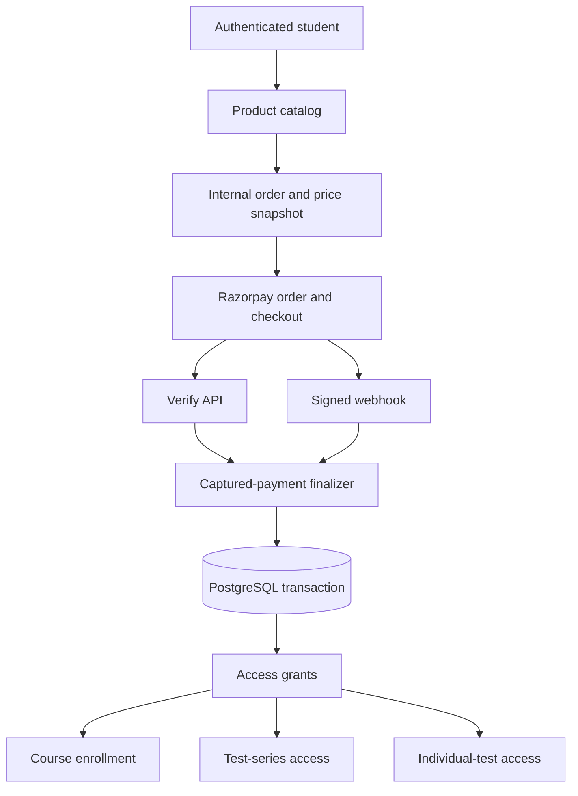

# Commerce, Razorpay, and LMS Access

This document describes BioLegacy's shared purchase architecture for courses, test series, individual tests, and bundles.

## Architecture



There is one `Product -> Order -> Payment -> Access Grant` pipeline. Product items determine what access is granted; no payment code is specific to NEET, B.Sc Nursing, a subject, or a particular course.

## Product and test-series model

- `products` supports `COURSE`, `TEST_SERIES`, `TEST`, and `BUNDLE`.
- Money is stored in integer minor units (`price_minor`, `amount_minor`). INR 999 is stored as `99900`.
- `product_items` maps a product to one or more courses, test series, or tests. A bundle is simply a product with multiple items.
- Access can be `LIFETIME`, `DURATION`, or `FIXED_DATE`.
- `test_series_tests` is the many-to-many mapping between tests and series, so the same test can appear in a subject series and a complete series without duplication.
- `test_series_groups` provides configurable headings such as Physics, Chemistry, Biology, Full Mock, or Nursing Foundation. These names are content, not payment logic.
- `tests.exam_type` keeps NEET, B.Sc Nursing, and future exam collections isolated. `tests.is_free` permits access without a purchase.
- Admin writes reject test/series and product/content exam-type mismatches. The runtime access resolver also requires the containing series and test to share an exam type, so a bad legacy mapping cannot leak access across exams.

Products created by the migration backfill are `DRAFT`. Review price, access duration, mappings, and copy in `/admin/commerce` before changing a product to `ACTIVE`.

## Database tables

| Table | Purpose |
| --- | --- |
| `products`, `product_items` | Purchasable catalog and access targets |
| `orders` | Customer, product/pricing snapshots, totals, gateway order, and state |
| `payments` | Captured/failed gateway payment records |
| `access_grants` | Active or revoked course/series/test entitlements with expiry |
| `coupons` and scope tables | Product, product-type, exam, and user coupon restrictions |
| `coupon_redemptions` | Reserved/redeemed/released usage accounting |
| `refunds` | Full/partial refund state and explicit access policy |
| `payment_webhook_events` | Signed event idempotency, retry state, and reconciliation |
| `test_series_tests`, `test_series_groups` | Reusable tests and display groups |

Course purchases also upsert the existing `enrollments` row with `source_type='PURCHASE'`. Existing admin-created enrollments stay `MANUAL`, preserving the original LMS behavior.

## Purchase flows

### Course

Create an active `COURSE` product with a course item. A captured payment creates an access grant and activates the existing course enrollment. Course learning APIs require the grant to remain active for purchase-sourced enrollments.

### Complete or subject test series

Create the series, assign tests through `/admin/test-management` Membership, then create an active `TEST_SERIES` product targeting that series. A series grant makes every active mapped test accessible. A NEET Physics product receives only its configured series; a B.Sc Nursing product receives only its configured series.

### Individual test

Create a `TEST` product containing exactly the intended test item. The resulting grant does not unlock other tests or the parent series.

### Bundle

Create a `BUNDLE` product with any required course, series, and/or test items. Payment grants each configured target in the same transaction.

### Free test

Set `tests.is_free=true`. The centralized access resolver returns free access and no Razorpay order is required.

## Access control

`commerce/access.service.js` is the authority for access. `canAccessTest(userId, testId)` checks, in order:

1. Free-test status.
2. A valid individual-test grant.
3. A valid grant for any active series containing the test.
4. Public, selected-user, course-enrollment, and backward-compatible authenticated access rules.

Active grants require `starts_at <= NOW()` and an unexpired `expires_at`. Test detail, start, attempt hydration/resume, answer persistence, submit, result, and review paths call this backend resolver. Frontend lock states are only presentation.

Checkout also refuses an active fixed-date product after its configured access end. This prevents accepting money for an entitlement that can no longer become active.

## API

All paths are under `/api/v1`.

### Student/catalog

| Method | Path | Purpose |
| --- | --- | --- |
| `GET` | `/commerce/products` | Active products; optional `type` and `examType` filters |
| `GET` | `/commerce/products/:identifier` | Product by UUID or slug |
| `GET` | `/commerce/orders` | Authenticated student's purchase history |
| `GET` | `/commerce/orders/:id` | Authenticated student's order |
| `POST` | `/payments/create-order` | Create/reuse checkout from server-side product price |
| `POST` | `/payments/verify` | Verify checkout signature and captured gateway payment |
| `POST` | `/payments/cancel` | Cancel an open local order |
| `POST` | `/payments/webhook` | Raw-body Razorpay webhook |

`create-order` accepts only `productId` and optional `couponCode`. Extra fields such as `amount`, `discount`, or `productType` are stripped and never used as price authority.

### Admin

| Method | Path | Purpose |
| --- | --- | --- |
| `GET/POST/PUT` | `/admin/commerce/products` | Catalog and item management |
| `GET/POST/PUT` | `/admin/commerce/coupons` | Coupon and scope management |
| `GET` | `/admin/commerce/orders` | Orders |
| `GET` | `/admin/commerce/payments` | Payments and refundable balances |
| `GET` | `/admin/commerce/analytics` | Revenue, failures, refunds, exam/type split, top products |
| `POST` | `/admin/commerce/payments/:id/refund` | Full or partial Razorpay refund |
| `POST` | `/admin/commerce/reconcile` | Retry failed, previously verified webhook events |
| `GET/PUT` | `/admin/test-management/series/:id/membership` | Series groups and reusable test mappings |

Admin commerce/refund endpoints require an active `TEACHER_ADMIN` account.

## Razorpay configuration

Set these only in the backend environment:

```dotenv
RAZORPAY_KEY_ID=rzp_test_...
RAZORPAY_KEY_SECRET=...
RAZORPAY_WEBHOOK_SECRET=...
RAZORPAY_API_BASE_URL=https://api.razorpay.com/v1
```

The browser receives only the key ID returned with checkout data. Never put key or webhook secrets in `NEXT_PUBLIC_*` variables.

In the Razorpay dashboard, create a webhook pointing to:

```text
https://API_HOST/api/v1/payments/webhook
```

Subscribe to `payment.captured`, `payment.failed`, `refund.created`, and `refund.processed`. Configure the same webhook secret in Razorpay and the backend. The webhook route uses the exact raw request bytes before JSON parsing.

## Idempotency and reconciliation

- A partial unique index permits only one open order per student/product.
- Expired open orders are cancelled and their coupon reservations released before a new checkout is created.
- Gateway order and payment IDs are unique.
- Webhook event IDs are unique; a body hash is used if the gateway event header is absent.
- Access grants are unique per order/target, and course enrollment uses the existing student/course uniqueness rule.
- Verify and webhook delivery call the same captured-payment finalizer under a row lock and database transaction.
- Failed signed events stay in `payment_webhook_events` and can be retried from admin or by scheduler:

```bash
npm run payments:reconcile -- 50
```

Run this command periodically in production as a safety net. Ordinary browser-close and network-loss cases are resolved by the webhook without the frontend callback.

## Coupons

Coupons validate status, start/expiry, global and per-user limits, minimum value, maximum discount, allowed products, product types, exam types, and users. A pending checkout reserves usage. Failure, cancellation, or expiry releases it; successful payment redeems it. Fixed discounts are entered in major currency units in admin and converted to minor units by the backend.

## Refunds

Refunds are admin-only and support full or partial amounts. The administrator must choose one policy:

- `KEEP`: refund money but retain access.
- `REVOKE`: revoke grants for that order and cancel purchase-sourced course enrollment.

The choice is stored with the refund instead of silently applying a business policy. Razorpay webhooks reconcile asynchronous refund completion.

## Tests and local validation

```bash
cd biolegacy_backend
npm run db:migrate
npm test

cd ../biolegacy_frontend/biolegacy
npm run lint
npm run build
```

Automated tests cover signature validation/tampering, amount/order/currency/status checks, server-side price authority, minor-unit coupon math, lifetime/duration/fixed access, free/direct/series access, exam isolation behavior, authentication suspension, attempt eligibility, and scoring.

Before production launch, complete Razorpay TEST-mode checkout scenarios for successful, failed, cancelled, duplicate callback/webhook, browser-close, refund, and gateway/network failure. These require real test credentials and cannot be meaningfully exercised without contacting Razorpay.

## Production deployment

1. Back up PostgreSQL and deploy the backend first.
2. Configure production database/JWT/Razorpay values in the secret manager.
3. Run `npm run db:migrate`. Migrations are additive and tracked in `schema_migrations`.
4. Review backfilled draft products in `/admin/commerce`; configure prices/items/validity before activation.
5. Configure and test the HTTPS Razorpay webhook.
6. Deploy the frontend and confirm its API base URL.
7. Run one low-value test-mode purchase for each product shape, then repeat the operational checklist in live mode using an approved minimal product.
8. Schedule `npm run payments:reconcile` and monitor failed webhook events, failed orders, and refund status.

Do not activate incomplete products, run destructive schema resets, or copy TEST secrets into production.

## Troubleshooting

- **Online payments are not configured:** one or more backend Razorpay variables is missing.
- **Invalid webhook signature:** confirm the webhook secret and that no proxy transforms the request body.
- **Payment captured but access missing:** inspect the event's `last_error`, correct the underlying mapping/data issue, then reconcile.
- **Payment amount mismatch:** the Razorpay payment is not for the stored internal order; access is intentionally denied.
- **Purchase required after payment:** verify product items point to the intended series/test and the series membership is active.
- **Coupon appears consumed after abandoned checkout:** wait for/cancel the checkout; expired open orders are released when checkout is retried.
- **B.Sc Nursing test rejected from a NEET series:** exam types must match by design; create or select the correct series.
